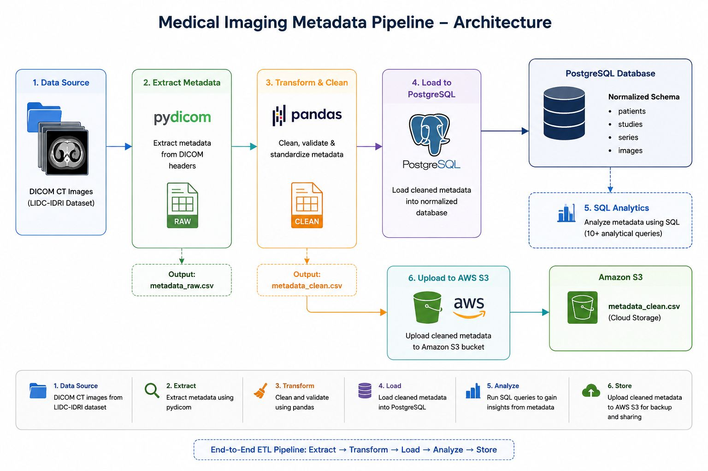
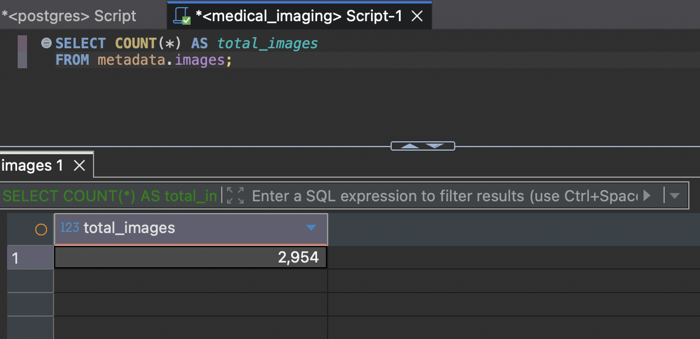
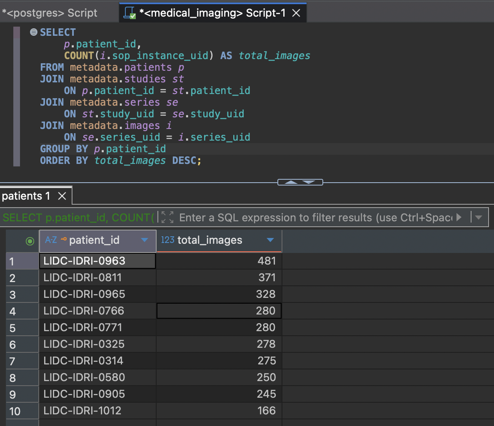
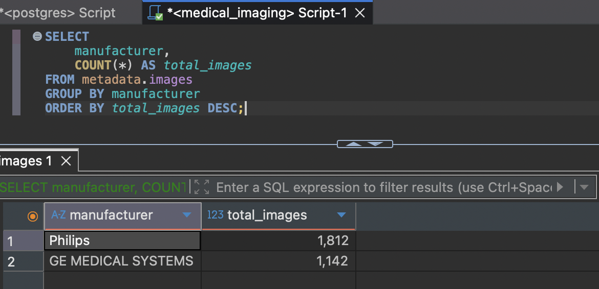
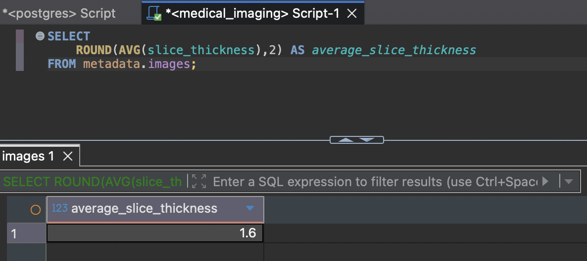
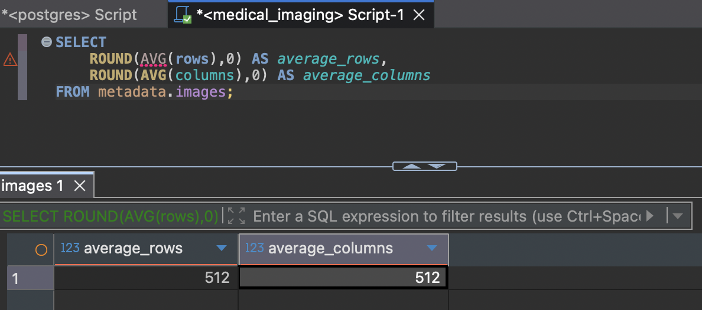
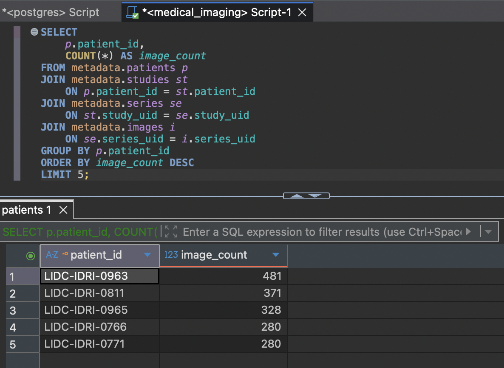

# Medical Imaging Metadata Pipeline

An end-to-end ETL pipeline built using Python, PostgreSQL, and AWS S3 to extract, clean, store, and analyze metadata from DICOM CT images.

## Project Overview

This project uses the LIDC-IDRI dataset from The Cancer Imaging Archive (TCIA). The pipeline extracts metadata from DICOM files using Python, cleans and validates the extracted data, stores it in a normalized PostgreSQL database, and uploads the cleaned dataset to Amazon S3.

The project also includes SQL queries to analyze the stored metadata.

## Architecture



## Tech Stack

- Python
- PostgreSQL
- SQL
- pandas
- pydicom
- boto3
- AWS S3
- Git & GitHub

## Dataset

**Source:** The Cancer Imaging Archive (TCIA)

**Collection:** LIDC-IDRI

**Imaging Modality:** CT

### Dataset Summary

- Patients: 10
- Images: 2,954
- Metadata extracted from DICOM headers

## Project Structure

```text
Medical_Imaging_Metadata_Pipeline/
│
├── data/
├── database/
│   ├── schema.sql
│   └── analytics.sql
├── processed/
├── screenshots/
├── scripts/
├── README.md
└── requirements.txt
```

## ETL Pipeline

1. Extract metadata from DICOM CT images using **pydicom**.
2. Clean and validate the extracted metadata using **pandas**.
3. Load the cleaned metadata into a normalized PostgreSQL database.
4. Upload the cleaned dataset to Amazon S3 using **boto3**.

## Database Schema

The metadata is stored in a normalized PostgreSQL schema consisting of:

- Patients
- Studies
- Series
- Images


## SQL Analytics

### Total Number of Images



---

### Images per Patient



---

### Images by Scanner Manufacturer



---

### Average Slice Thickness



---

### Average Image Resolution



---

### Top 5 Patients with the Highest Number of Images



> The complete set of SQL queries is available in `database/analytics.sql`.


## AWS S3 Integration

The cleaned metadata (`metadata_clean.csv`) is uploaded to an Amazon S3 bucket using the AWS SDK for Python (`boto3`).

This provides cloud storage for the processed dataset and simulates a common data engineering workflow.

## How to Run

```bash
git clone https://github.com/Sachinkumar-23D242/Medical-Imaging-Metadata-Pipeline.git

cd Medical-Imaging-Metadata-Pipeline

python3 -m venv venv

source venv/bin/activate

pip install -r requirements.txt
```

Run the pipeline:

```bash
python scripts/extract_metadata.py

python scripts/clean_metadata.py

python scripts/load_postgres.py

python scripts/upload_s3.py
```

## Future Improvements

- Automate the pipeline using Apache Airflow
- Store metadata in Amazon RDS
- Add Docker support
- Build a dashboard for metadata visualization
- Process larger DICOM collections


## Author

**Sachin Kumar**

- GitHub: https://github.com/Sachinkumar-23D242
- LinkedIn: https://www.linkedin.com/in/msachinkumar/